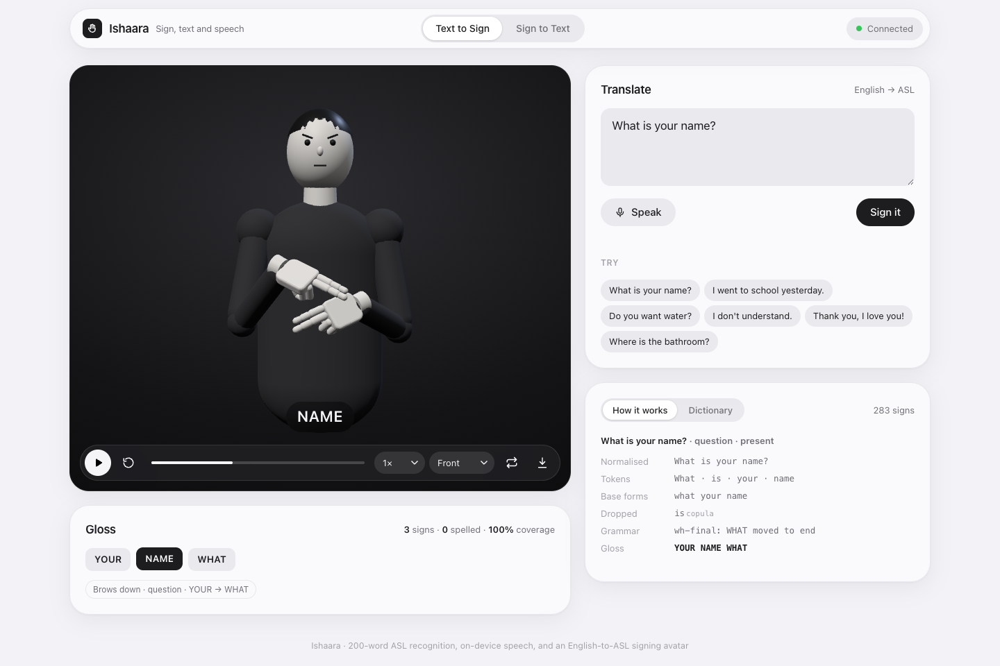
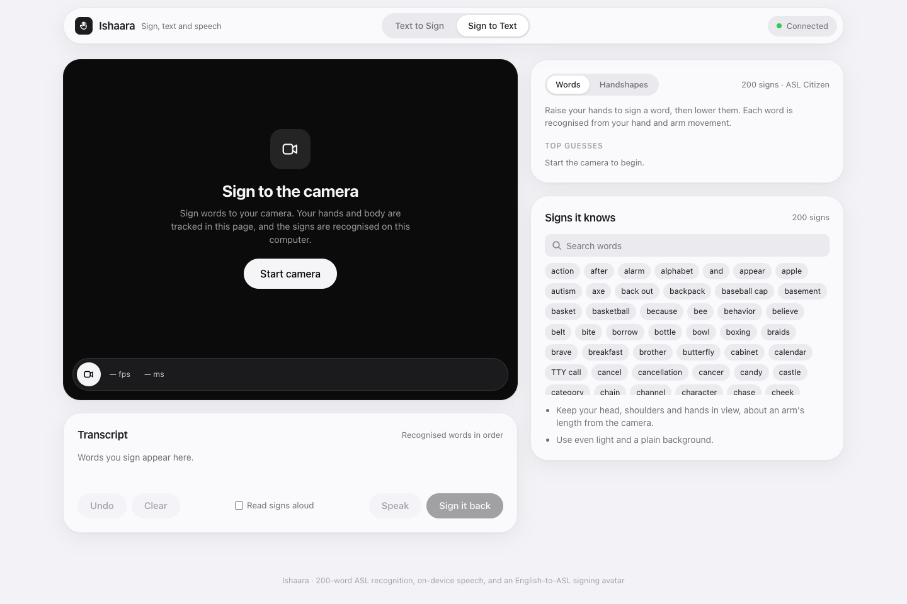
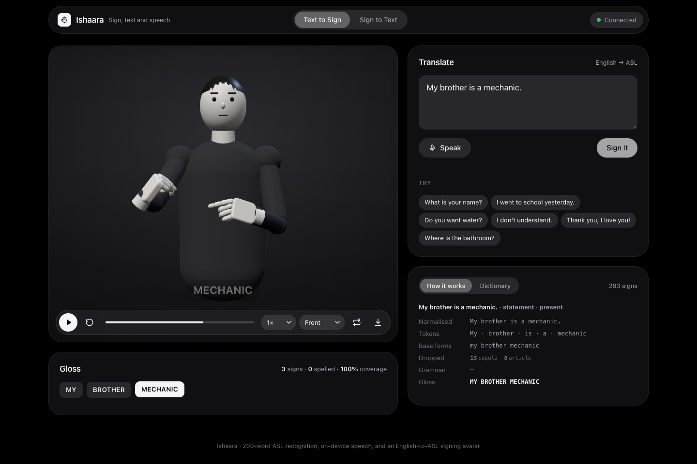
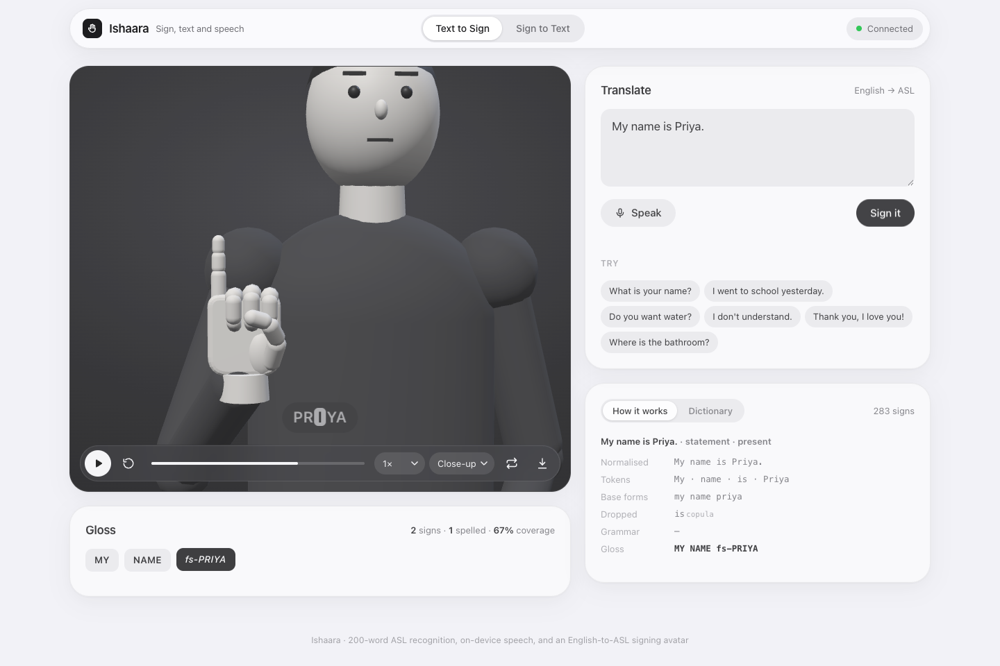
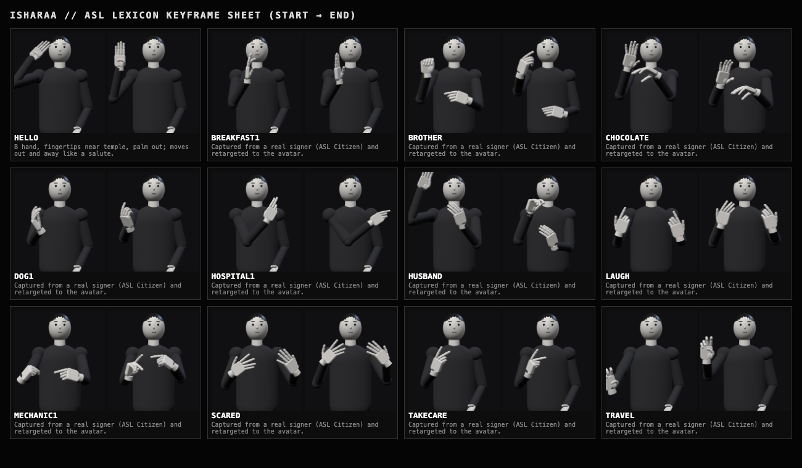
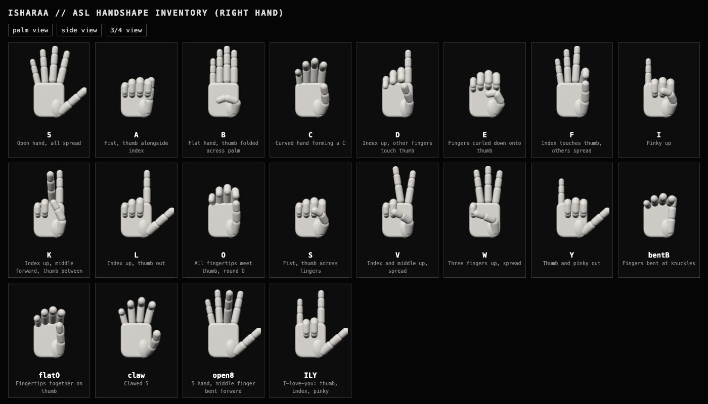

# Ishaara: sign, text and speech translation for ASL

**Ishaara** (Hindi for *gesture*) is a two-way communication system between American Sign Language and English. You can sign to your webcam and get English text and speech, or type or speak English and watch a 3D avatar sign it back. Everything runs on your own computer, and nothing is sent to an external service.



## Features

| Direction | How it works |
|---|---|
| **Sign → Text** (200 words) | Hands and body are tracked in the browser with MediaPipe. A transformer sequence model, trained on ASL Citizen, recognises one word at a time: raise your hands, sign, lower them. |
| **Sign → Text** (handshapes) | A DETR detector (ResNet-50 + transformer), fine-tuned on our own photos, recognises 5 static signs frame by frame. |
| **Text → Sign** | A rule-based NLP engine turns English into an ASL gloss: time-first, WH-final, lexical tense, non-manual markers, fingerspelling. A procedural three.js avatar signs it, with 103 hand-authored signs plus 180 retargeted from real signers. |
| **Speech → Sign** | Press **Speak**. Whisper (`base.en`) transcribes speech locally and the avatar signs it. |
| **Sign → Speech** | Recognised words are read aloud by the browser's built-in voices. |

**Sign it back** sends a recognised transcript straight to the avatar, so the two directions connect.

## Screenshots

<table>
<tr>
<td width="50%"><br><sub><b>Sign → Text.</b> Words mode, with top-5 guesses and the 200-word vocabulary.</sub></td>
<td width="50%"><br><sub><b>Dark mode.</b> "My brother is a mechanic", signed with motion captured from real signers.</sub></td>
</tr>
<tr>
<td><br><sub><b>Fingerspelling.</b> Names and unknown words are spelled letter by letter, and the caption follows along.</sub></td>
<td><br><sub><b>Captured signs.</b> Real signing performances retargeted onto the avatar.</sub></td>
</tr>
</table>


<sub>The avatar's handshape inventory. Thumb poses are solved by contact-constrained inverse kinematics.</sub>

## Quick start

Requirements: macOS, Linux or Windows; Python 3.13; [uv](https://docs.astral.sh/uv/); a recent Chrome or Edge browser. Node.js is optional; it's only needed for the developer tools.

```bash
git clone https://github.com/shanmuckh/isharaa.git
cd isharaa
pip install uv          # if you don't have it yet
uv sync                 # installs PyTorch, OpenCV, faster-whisper, …
uv run python app.py    # opens http://localhost:8000
```

- **Text to Sign**: type a sentence and press **Sign it**, or press **Speak**.
- **Sign to Text**: press **Start camera** and allow access. Pick **Words** (200 ASL words) or **Handshapes** (5 signs).

The first run downloads the Whisper speech model (about 150 MB). After that the app works offline. The trained models are included in `pretrained/` through Git LFS; if they're missing after cloning, run `git lfs pull`.

## Results

| Component | Evaluation | Result |
|---|---|---|
| Word recogniser (200 signs) | ASL Citizen validation clips | **89.0 %** top-1 · 96.2 % top-5 |
| | WLASL cross-dataset (other signers, cameras and rooms) | **74.8 %** top-1 · 89.1 % top-5 |
| Handshape detector (5 signs) | 25 held-out photos | 100 % accuracy · IoU 0.80 · 19 ms/frame (Apple M2) |
| English → ASL gloss | 50-sentence set | BLEU-4 81.7 · WER 7.7 % |
| Speech recognition | 50 sentences, synthetic voice | 0 % WER, 2.3× real time on CPU (an upper bound) |

Details, data issues and limitations are in [docs/](docs/): [SIGN_WORDS.md](docs/SIGN_WORDS.md), [SIGN_TO_TEXT.md](docs/SIGN_TO_TEXT.md), [TEXT_TO_SIGN.md](docs/TEXT_TO_SIGN.md) and [SPEECH.md](docs/SPEECH.md).

## Train on your own signs (handshape detector)

The personal training photos used for the 5-sign detector are **not** in this repository. To train the detector on your own images:

1. **Collect images.** Set the sign names in `src/utils/collect_images.py`, then run
   ```bash
   uv run python src/utils/collect_images.py
   ```
   It saves webcam photos to `data/train/images`. Collect about 30 per sign, plus about 5 per sign for `data/test/images` (change the output folder at the bottom of the script).
2. **Label them.** Start Label Studio, create an object-detection project, and draw a box around each hand with its sign name:
   ```bash
   uv run label-studio
   ```
3. **Export** in **YOLO** format and copy each `labels/` folder next to its `images/` folder, so you have `data/train/{images,labels}` and `data/test/{images,labels}`.
4. **List your classes** in `src/config.json`, **in alphabetical order**, which is the order Label Studio numbers them in.
5. **Train and evaluate:**
   ```bash
   uv run python src/train.py                 # ~15 min on an M-series Mac; exports pretrained/ishaara_5class.pt
   uv run python src/evaluate_detector.py     # accuracy, IoU, confusion matrix, latency
   ```
   The training script checks every label against its file name, to catch class-order mistakes. The running app picks up new weights automatically.

Keep the subject's whole upper body in frame, use a few different backgrounds and lighting conditions, and photograph several people if you can.

## Train the word recogniser (200 signs)

```bash
uv run python src/signs/download.py      # ASL Citizen landmarks, ~1.9 GB (CC BY-NC-SA 4.0)
uv run python src/signs/train.py         # ~25 min on an M2; exports pretrained/signs200.pt
```

To rebuild the avatar's captured signs from the same data:

```bash
uv run python src/signs/export_motion.py
node static/text2sign/tools/retarget.mjs
```

## Project structure

```
app.py                     web server and API (/api/sign, /api/detect, /api/translate, /api/transcribe)
index.html                 single-page app
src/
  signs/                   200-word recogniser: features, model, training, evaluation, motion export
  text2sign/               English → ASL gloss translator, sign lexicon, captured signs
  detector.py              DETR handshape service      model.py · loss.py · train.py · data.py
  speech.py                local Whisper speech recognition
static/
  sign2text/               camera, MediaPipe tracking, word segmentation, overlays
  text2sign/               avatar, keyframe timeline, sign gallery and sheet, tools
  speech/                  microphone capture and speech output
  vendor/                  three.js and MediaPipe (bundled so the app works offline)
tests/                     unit tests                  docs/  method notes and screenshots
```

## Tests and tools

```bash
uv run python -m unittest discover tests            # unit tests
uv run python src/text2sign/evaluate.py --errors    # gloss translator BLEU / WER
uv run python src/evaluate_speech.py                # speech WER and speed (macOS voice)
node static/text2sign/tools/validate.mjs            # kinematic check of every authored sign
```

Visual references: `/static/text2sign/gallery.html` (handshapes) and `/static/text2sign/sheet.html` (every sign).

## Limitations

- **Word recognition is isolated:** one word per raise-and-lower of the hands, from a fixed vocabulary of 200 words. Continuous signed sentences are not supported.
- **The validation split may share signers with training.** The WLASL score is the fairer measure of how well it generalises to new people.
- **Most avatar signs have not been reviewed by a fluent signer.** The authored signs approximate citation forms, and some retargeted signs are rough. Have an ASL user review them before relying on them.
- **The gloss translator is rule-based.** It does not handle topicalisation, classifiers or role shift.

## Credits and licences

- **ASL Citizen** (Desai et al., NeurIPS 2023), used through the keypoint release on Hugging Face under CC BY-NC-SA 4.0. **WLASL** (Li et al., WACV 2020) for cross-dataset evaluation.
- [MediaPipe](https://developers.google.com/mediapipe) and [three.js](https://threejs.org) (Apache 2.0 / MIT), [faster-whisper](https://github.com/SYSTRAN/faster-whisper) with OpenAI Whisper.
- The DETR training code started from Nick Renotte's [SignDETR](https://github.com/nicknochnack/SignDETR) tutorial (MIT).

Ishaara's own code is for academic use. The ASL Citizen-derived files (`pretrained/signs200.pt`, `src/text2sign/data/clips.json`) inherit the dataset's non-commercial share-alike terms.
